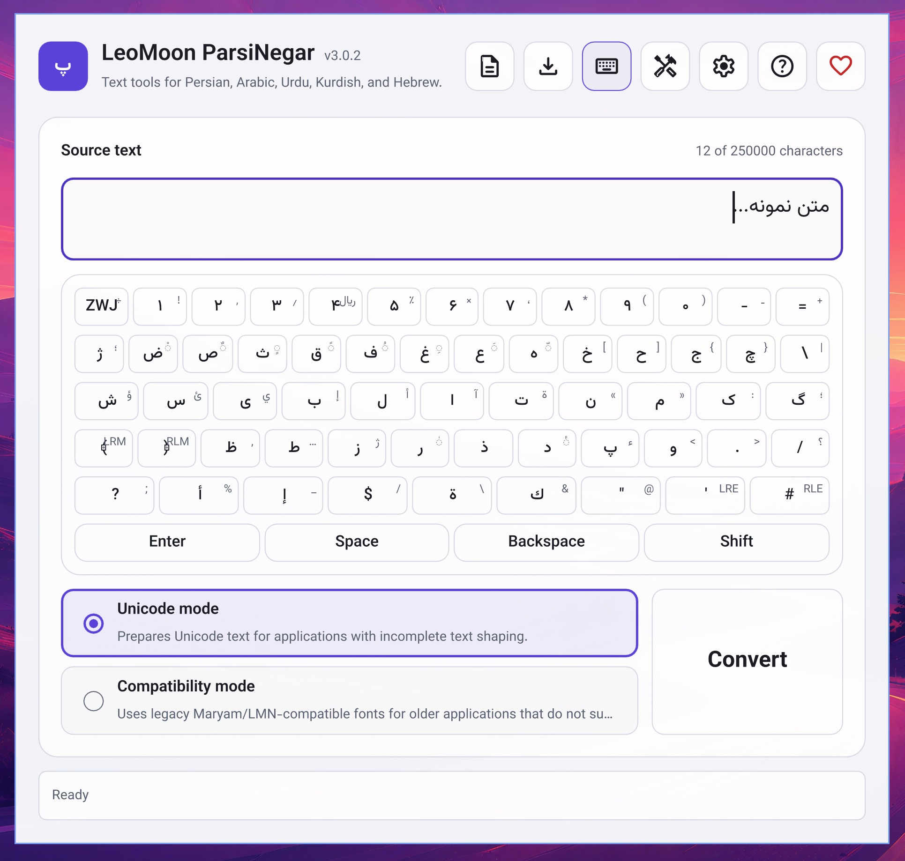
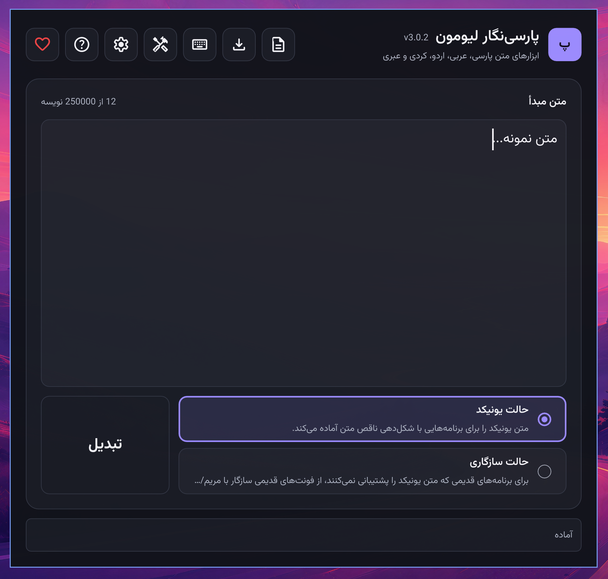
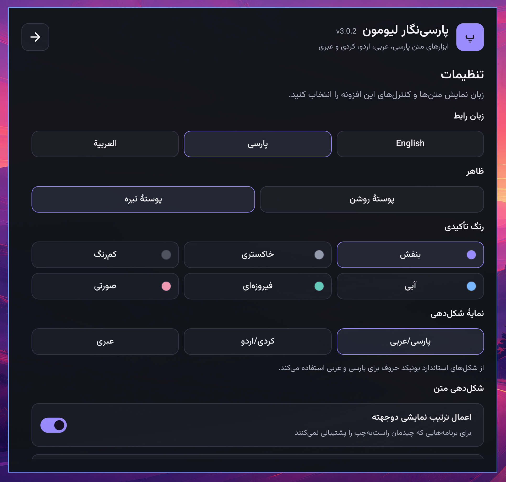
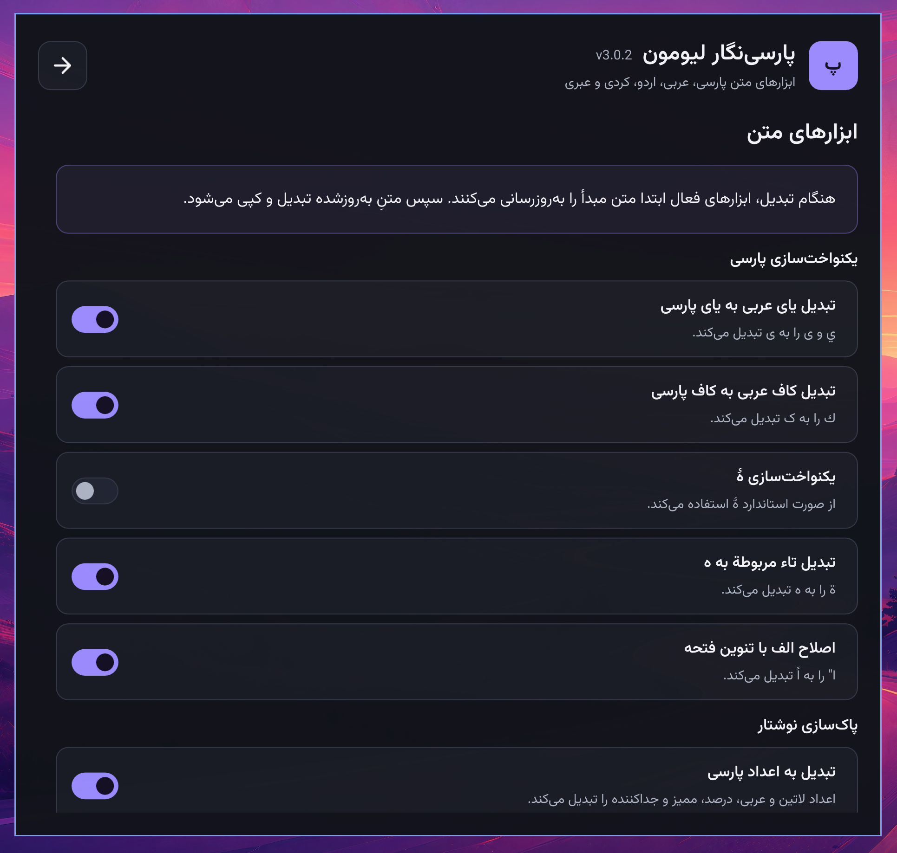

# لیومون پارسی‌نگار

**زبان:** پارسی | [English](README.md)

## معرفی

> بدون راهی آزاد و آسان برای تایپ کردن، فرهنگ پارسی نمی‌تواند پیشرفت کند.

لیومون پارسی‌نگار یک برنامهٔ رومیزی آزاد و متن‌باز برای آماده‌سازی متن پارسی، عربی، اردو، کردی و عبری جهت استفاده در برنامه‌های دیگر است. این برنامه به‌ویژه زمانی کاربرد دارد که یک نرم‌افزار گرافیکی یا ویرایش ویدئو، متن راست‌به‌چپ را درست شکل‌دهی نمی‌کند. متن را در پارسی‌نگار بنویسید یا جای‌گذاری کنید، آن را تبدیل کنید و نتیجه را در برنامهٔ موردنظر بچسبانید. همچنین می‌توانید متن را به منحنی‌های SVG قابل‌ویرایش تبدیل کنید تا طرح شما حتی در رایانه‌ای که قلم موردنظر را ندارد، ظاهر یکسانی داشته باشد.

پارسی‌نگار از سال ۲۰۰۸ نگهداری شده و برای نسخهٔ کنونی با Qt 6 به‌صورت برنامه‌ای چندسکویی بازنویسی شده است. این بازنویسی نگهداری پروژه را آسان‌تر کرده، ساخت خودکار را فراهم آورده و کد منبع را در دسترس همگان گذاشته است.

## پیش‌نمایش‌ها

ویرایشگر پارسی‌نگار به زبان انگلیسی با پوستهٔ روشن


ویرایشگر پارسی‌نگار به زبان پارسی با پوستهٔ تیره


صفحهٔ تنظیمات به زبان پارسی با پوستهٔ تیره


صفحهٔ ابزارهای متن به زبان پارسی با پوستهٔ تیره


## امکانات

- تبدیل یونی‌کد و سازگاری برای برنامه‌هایی که پشتیبانی کاملی از متن راست‌به‌چپ ندارند:
  - حالت یونی‌کد برای برنامه‌هایی که متن یونی‌کد را می‌پذیرند، اما آن را به‌درستی شکل‌دهی یا مرتب نمی‌کنند.
  - حالت سازگاری برای برنامه‌های قدیمی که به کدهای نویسهٔ قدیمی مریم/LMN و قلم سازگاری متناظر نیاز دارند. نمایهٔ عبری فقط از حالت یونی‌کد استفاده می‌کند.
- ویرایشگر مستقل با صفحه‌کلید روی صفحه، ذخیرهٔ سند متنی ساده، واگرد و بازانجام و ابزارهایی برای پاک‌سازی یا تغییر متن ورودی.
- خروجی SVG به‌شکل منحنی با قلم انتخابی، گزینشگر قلم‌های نصب‌شده، پیش‌نمایش درخواستی و هشدار دربارهٔ نویسه‌های فاقد نقش در قلم.
- رابط کاربری به زبان‌های انگلیسی، پارسی و عربی، پوسته‌های روشن و تیره و امکان انتخاب رنگ تأکیدی.
- استفادهٔ آفلاین در ویندوز، macOS و لینوکس.

## روش استفاده

1. بستهٔ مناسب رایانهٔ خود را از [صفحهٔ انتشارهای گیت‌هاب](https://github.com/leomoon-studios/leomoon-parsinegar/releases) دریافت کنید. برای ویندوز نصب‌کننده‌های x64 و ARM64، برای macOS فایل‌های DMG و PKG همگانی و برای لینوکس AppImageهای x86_64 و ARM64 ارائه می‌شوند. در لینوکس، پیش از اجرای AppImage آن را قابل‌اجرا کنید.
2. متن اصلی را در بخش **متن ورودی** بنویسید یا جای‌گذاری کنید. برای نگه‌داشتن نسخه‌ای از متن، از منوی **سند** آن را به‌صورت فایل متنی ساده ذخیره کنید. همچنین می‌توانید پیش از تبدیل، متن ورودی را با **ابزارهای متن** پاک‌سازی یا تغییر دهید.
3. در صورت نیاز، **تنظیمات** را باز کنید و نمایهٔ شکل‌دهی پارسی و عربی، کردی و اردو یا عبری را انتخاب کنید. برای برنامه‌ای که متن یونی‌کد می‌پذیرد، **حالت یونی‌کد** را انتخاب کنید. برای برنامهٔ قدیمی که به قلم مریم/LMN متناظر نیاز دارد، **حالت سازگاری** را برگزینید.
4. روی **تبدیل** کلیک کنید یا `Ctrl+Enter` را بزنید. پارسی‌نگار متن تبدیل‌شده را در کلیپ‌بورد کپی می‌کند تا بتوانید آن را در برنامهٔ مقصد جای‌گذاری کنید. در حالت سازگاری، قلم سازگاری متناظر را در برنامهٔ مقصد نیز انتخاب کنید؛ در غیر این صورت ممکن است نویسه‌های جای‌گذاری‌شده به‌شکل دلخواه نمایش داده نشوند.

برای ساخت SVG، متن ورودی را وارد کنید و بخش **خروجی SVG** را باز کنید. حالت تبدیل و قلم مناسب را انتخاب کنید، اندازه، فاصله‌گذاری و تراز را تنظیم کنید و سپس برای بررسی نتیجه روی **پیش‌نمایش** کلیک کنید. پس از هر تغییر از **به‌روزرسانی پیش‌نمایش** استفاده کنید. اگر پیش‌نمایش دربارهٔ نبودن نقش برخی نویسه‌ها هشدار داد، پیش از زدن **ذخیرهٔ SVG** قلم دیگری انتخاب کنید. خروجی SVG از منحنی‌ها ساخته می‌شود، بنابراین برای حفظ ظاهر نوشته در رایانهٔ مقصد نیازی به نصب قلم نیست.

خروجی SVG قلم‌های TrueType و OpenType/CFF تا اندازهٔ ۵ مگابایت را می‌پذیرد. پیش از اجرای تجزیه‌گر Typr.js همراه برنامه، فایل `qml/core/SafeTypr.js` ساختار جدول‌های قلم، جابه‌جایی‌های CFF INDEX، شمار گروه‌های cmap قالب ۱۲ و محدودهٔ خواندن بایت‌ها را بررسی می‌کند. قلم نامعتبر با خطای `INVALID_FONT` رد می‌شود و فایل SVG ذخیره نمی‌شود. این بررسی‌ها برای جلوگیری از خواندن یا تخصیص حافظهٔ خارج از محدوده و بیش‌ازحد بزرگ طراحی شده‌اند، اما اعتبارسنجی کامل قالب قلم نیستند و جای استفاده از قلم‌های مورداعتماد را نمی‌گیرند.

قلم‌های سازگاری اختیاری هستند. نصب‌کننده‌های ویندوز و macOS گزینهٔ نصب این قلم‌ها را به‌صورت پیش‌فرض فعال دارند. AppImageهای لینوکس قلم‌ها را در سطح سیستم نصب نمی‌کنند؛ کاربران اوبونتو می‌توانند بستهٔ جداگانهٔ `.deb` قلم‌ها را نصب کنند و کاربران دیگر توزیع‌ها می‌توانند از فایل ZIP قلم‌ها و دستورالعمل همراه آن استفاده کنند. این قلم‌ها فقط برای خروجی حالت سازگاری یا استفاده از آن‌ها در خروجی SVG لازم‌اند.

## میانبرهای صفحه‌کلید

- `Ctrl+Enter`: تبدیل
- `Ctrl+,`: نمایش یا پنهان‌کردن تنظیمات
- `Ctrl+T`: نمایش یا پنهان‌کردن ابزارهای متن
- `Ctrl+E`: نمایش یا پنهان‌کردن بخش خروجی
- `Ctrl+H`: نمایش یا پنهان‌کردن راهنما
- `Ctrl+wheel`: تغییر اندازهٔ متن ویرایشگر (`Command+wheel` در macOS)

منوی سند میانبرهای `Ctrl+N` (سند تازه)، `Ctrl+O` (باز کردن)، `Ctrl+S` (ذخیره) و `Ctrl+Shift+S` (ذخیره به نام) را نیز دارد.

## ساخت از کد منبع

پیش‌نیازها:

- CMake نسخهٔ 3.21 یا جدیدتر
- Qt نسخهٔ 6.5 یا جدیدتر به‌همراه مؤلفه‌های توسعهٔ Core، Concurrent، Gui، Svg، Qml، Quick، Quick Controls 2، Quick Test و Test
- کامپایلر C++17 پشتیبانی‌شده توسط نسخهٔ Qt انتخابی
- Ninja پیشنهاد می‌شود، اما ضروری نیست

در پوشهٔ اصلی مخزن اجرا کنید:

```sh
cmake -S . -B build -G Ninja -DCMAKE_BUILD_TYPE=Debug
cmake --build build
ctest --test-dir build --output-on-failure
cmake --build build --target parsinegar_ui_qmllint
```

برای اجرای برنامه در لینوکس از `./build/leomoon-parsinegar`، در macOS از `open "build/LeoMoon ParsiNegar.app"` و در ویندوز از `.\build\leomoon-parsinegar.exe` استفاده کنید. اگر CMake نتوانست Qt را پیدا کند، `CMAKE_PREFIX_PATH` را روی مسیر نصب Qt تنظیم کنید. در ویندوز، پیکربندی را از Developer PowerShell سازگار با کیت کامپایلر Qt اجرا کنید.

## بسته‌بندی و انتشار

بسته‌بندی انتشار برای هر سکو جداگانه انجام می‌شود. لینوکس AppImageهای x86_64 و ARM64، ویندوز نصب‌کننده‌های Inno Setup برای x64 و ARM64 و macOS بسته‌های DMG و PKG همگانی برای پردازنده‌های Intel و Apple Silicon ارائه می‌کند. قلم‌های سازگاری لینوکس به‌صورت جداگانه در بستهٔ `.deb` مستقل از معماری برای اوبونتو یا فایل ZIP برای نصب دستی در دسترس‌اند. نصب‌کننده‌های ویندوز و macOS گزینه‌هایی برای نصب قلم‌های سازگاری همراه برنامه در سطح سیستم و ساخت میانبر دسکتاپ دارند که به‌صورت پیش‌فرض فعال‌اند. برای پیش‌نیازهای هر سکو و گزینه‌های امضای دیجیتال، فایل‌های بسته‌بندی CMake و گردش‌کار انتشار را ببینید.

قلم‌های سازگاری همراه پروژه در `assets/fonts/system/` قرار دارند. قلم‌های Vazirmatn و Material Symbols برای رابط کاربری در خود برنامه گنجانده شده‌اند.

AppImageهای لینوکس قلم‌های اختیاری را در سطح سیستم نصب نمی‌کنند. کاربران اوبونتو می‌توانند بستهٔ جداگانهٔ `leomoon-parsinegar-fonts-<version>-ubuntu-all.deb` را نصب کنند. کاربران پیشرفتهٔ دیگر توزیع‌های لینوکس می‌توانند فایل `leomoon-parsinegar-fonts-<version>-linux-all.zip` را استخراج کنند و برای نصب دستی از `FONTS-README.txt` داخل آن کمک بگیرند. هر دو بسته، قلم‌های LMN و LMU یکسانی دارند و هیچ‌کدام شامل خود برنامه نیستند.

ارسال برچسبی با قالب دقیق `vX.Y.Z` گردش‌کار انتشار را آغاز می‌کند. این گردش‌کار مقدار `metadata/VERSION` را از برچسب می‌گیرد، تاریخ جاری UTC را در `metadata/RELEASE_DATE` می‌نویسد و سپس ساخت‌های جداگانهٔ لینوکس، ویندوز و macOS را شروع می‌کند. انتشار در گیت‌هاب فقط پس از موفقیت همهٔ ساخت‌ها و آزمون‌های نصب پاک انجام می‌شود. صفحهٔ انتشار شامل فهرست کامیت‌ها، بایگانی‌های کد منبع گیت‌هاب، هر بستهٔ بومی به‌عنوان بارگیری جداگانه و یک فایل یکپارچهٔ `SHA256SUMS` است.

```sh
git tag v3.0.0
git push origin v3.0.0
```

### ساخت‌های آزمایشی دستی

گردش‌کار انتشار را می‌توان برای ساخت و آزمایش بسته‌ها، بدون ساخت برچسب یا انتشار در گیت‌هاب، به‌صورت دستی نیز اجرا کرد. نسخهٔ آزمایشی، سکوی هدف و معماری را با GitHub CLI مشخص کنید:

```sh
gh workflow run release.yml --ref master \
  -f version=3.0.0 \
  -f target=all \
  -f arch=all
```

ورودی `target` یکی از مقدارهای `all`، `linux`، `windows` یا `macos` را می‌پذیرد. ورودی `arch` می‌تواند `all`، `x64` یا `arm64` باشد؛ در لینوکس `x64` به `amd64` نگاشت می‌شود و در macOS همیشه بسته‌ای همگانی برای Intel و Apple Silicon ساخته می‌شود و انتخاب معماری نادیده گرفته می‌شود.

برای نمونه، فقط نصب‌کنندهٔ ویندوز ARM64 را بسازید و آزمایش کنید:

```sh
gh workflow run release.yml --ref master \
  -f version=3.0.0 \
  -f target=windows \
  -f arch=arm64
```

برای پیگیری آخرین اجرا در ترمینال از `gh run watch --exit-status` استفاده کنید یا آن را در زبانهٔ **Actions** مخزن ببینید. بسته‌های موفق را می‌توان از بخش **Artifacts** همان اجرا دریافت کرد. اجرای دستی هرگز کار انتشار را انجام نمی‌دهد.

ارسال تغییرات عادی شاخه‌ها بسته‌های انتشار را نمی‌سازد. گردش‌کار لینوکس با Qt 6.8.3 برای معماری‌های x86_64 و ARM64 بستهٔ AppImage بومی می‌سازد، مجموعهٔ کامل آزمون‌ها و بررسی QML را اجرا می‌کند، یک بستهٔ قلم اختیاری اوبونتو و یک فایل ZIP مستقل از معماری تولید می‌کند و اجرای برنامه را در X11 و Wayland بدون Qt SDK می‌آزماید. همچنین یکسان‌بودن فهرست قلم‌های هر دو بسته را بررسی می‌کند.

گردش‌کار ویندوز با Qt 6.8.3 و MSVC نصب‌کننده‌های بومی x64 و ARM64 را می‌سازد، همان آزمون‌ها و بررسی QML را اجرا می‌کند و محیط اجرای Qt را با `windeployqt` بسته‌بندی می‌کند. کارهای تازهٔ ویندوز برای هر معماری، حالت‌های پیش‌فرض نصب قلم و ساخت میانبر دسکتاپ، غیرفعال‌کردن هر دو گزینه، اجرای برنامه و حذف نصب را آزمایش می‌کنند. ساخت‌های برچسب‌دار می‌توانند با رازهای محافظت‌شدهٔ مخزن از امضای اختیاری Authenticode استفاده کنند. جزئیات در [امضای انتشار ویندوز](docs/WINDOWS_SIGNING.md) آمده است.

گردش‌کار macOS یک بستهٔ همگانی برای Intel و Apple Silicon می‌سازد، چارچوب‌ها و ماژول‌های QML خصوصی Qt را با `macdeployqt` در آن قرار می‌دهد و فایل‌های DMG و PKG نسخه‌دار تولید می‌کند. یک کار تازهٔ macOS تصویر دیسک، حالت‌های پیش‌فرض نصب قلم و ساخت میانبر دسکتاپ، غیرفعال‌کردن هر دو گزینه، اجرای برنامه و پاک‌سازی را آزمایش می‌کند. ساخت‌های برچسب‌دار می‌توانند با رازهای محافظت‌شدهٔ مخزن از امضای اختیاری Developer ID و تأیید اپل استفاده کنند. جزئیات در [امضا و تأیید انتشار macOS](docs/MACOS_SIGNING.md) آمده است.

## تنظیمات و حریم خصوصی

زبان رابط، اندازهٔ ویرایشگر، انتخاب‌های شکل‌دهی، تنظیمات ابزارهای متن، ترجیح‌های تبدیل، قلم‌های انتخاب‌شده و گزینه‌های خروجی SVG بین اجراهای برنامه حفظ می‌شوند. پیش‌نویس متن، خروجی تبدیل‌شده، محتوای کلیپ‌بورد، پیام‌های وضعیت و تاریخچهٔ واگرد هرگز در فایل تنظیمات نوشته نمی‌شوند.

پارسی‌نگار هنگام اجرا تازه‌ترین نسخهٔ منتشرشده را در گیت‌هاب بررسی می‌کند و اگر نسخهٔ تازه‌تری باشد، پیشنهاد می‌دهد صفحهٔ دریافت باز شود. گزینهٔ «دیگر اعلان نسخهٔ تازه را نشان نده» بررسی خودکار بعدی را غیرفعال می‌کند؛ می‌توانید آن را در تنظیمات دوباره فعال کنید. متن و تنظیمات شما در این بررسی به گیت‌هاب فرستاده نمی‌شوند.

تنظیمات در پوشهٔ پیکربندی عمومی سکو، زیر مسیر `leomoon-parsinegar/settings.json` ذخیره می‌شوند. در لینوکس این مسیر `~/.config/leomoon-parsinegar/settings.json` است.

## حذف برنامه

برنامه را با روش معمول حذف نصبِ بسته‌ای که نصب کرده‌اید، پاک کنید. برای پاک‌کردن ترجیح‌های ذخیره‌شده نیز پوشهٔ `leomoon-parsinegar` را از مسیر پیکربندی عمومی سکو حذف کنید. در لینوکس:

```sh
rm -rf ~/.config/leomoon-parsinegar
```

## مجوز

کد اصلی لیومون پارسی‌نگار تحت [مجوز MIT](LICENSE) منتشر شده است. اجزای شخص ثالث مجوزها و یادداشت‌های خود را حفظ می‌کنند. برای جزئیات به [THIRD_PARTY_NOTICES.md](THIRD_PARTY_NOTICES.md) و [SOURCES.md](SOURCES.md) مراجعه کنید.
